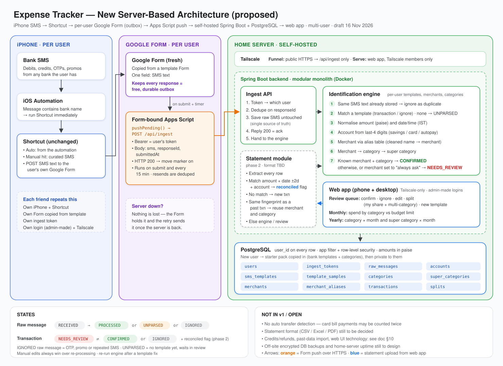

# Expense Tracker — New Server-Based Architecture (proposed, draft 2026-11-16)

_Diagram: [docs/new-server-based-architecture.svg](docs/new-server-based-architecture.svg) (PNG: [docs/new-server-based-architecture.png](docs/new-server-based-architecture.png)). Current system: [current-ARCHITECTURE.md](current-ARCHITECTURE.md). Options research: [RESEARCH.md](RESEARCH.md)._

## 1. In one paragraph
The iPhone side stays exactly as it is today: an iOS automation runs the Shortcut, which posts the SMS text to a Google Form. What changes is everything after the Form. The Google Sheet, its formulas and the Sheet-bound Apps Script are replaced by a **self-hosted backend (Spring Boot) and database (PostgreSQL)** running on a home server. Only the message-receiving address is on the public internet, through **Tailscale Funnel**; the web app is reachable only over Tailscale. A small script attached to the Form pushes every response to the backend and retries until it is received. The backend stores the raw message, works out what the transaction is, files it under a category, and shows it in a web app for review and dashboards. Several friends can use the same server, each with their own Form, token, login and private data.

## 2. End-to-end flow (one SMS)
1. **SMS arrives** on the user's iPhone.
2. **iOS automation** ("message contains <bank name>") runs the Shortcut immediately. For SMS the automation doesn't catch, the user runs the Shortcut by hand (a manual hit).
3. **Shortcut** posts the SMS text to the user's own **Google Form**. Nothing in the Shortcut changes apart from the Form address, because the new system uses a fresh Form.
4. **Google Form** saves the response. This is the free, durable outbox: once the Form has it, the message cannot be lost.
5. **Form-bound Apps Script** runs on the submission and sends `POST https://<host>.ts.net/api/ingest` with:
   - `Authorization: Bearer <user's ingest token>`
   - body: `sms`, `responseId` (the Form's unique response ID), `submittedAt`
6. **Tailscale Funnel** carries the HTTPS request to the backend on the home server.
7. **Ingest API**
   1. Looks up the token to find which user sent it.
   2. Drops duplicates using `responseId`, so a resent message is never stored twice.
   3. Saves the raw SMS untouched in `raw_messages`. This is the single source of truth.
   4. Replies `200`. The script moves its "sent up to here" marker forward.
   5. Hands the message to the identification engine.
8. **Identification engine** produces a transaction (see §4). If it recognises both the merchant and the category, the transaction is **CONFIRMED** automatically. Otherwise it goes to **NEEDS_REVIEW**, with the reasons.
9. **Web app**: the user fixes anything in the review queue, and the monthly and yearly dashboards update from confirmed transactions.

**If the server is down:** step 5 fails and the marker doesn't move. Every 15 minutes the script sends everything after the marker again, so the backend catches up when it comes back. Nothing is lost.

**If the backend crashes between steps 7.4 and 7.5:** the message is saved but not yet processed. A job that runs at startup and every few minutes picks up any message still in `RECEIVED` and processes it.

## 3. Components

### 3.1 iPhone, one per user (unchanged)
| Piece | Role |
|---|---|
| Bank SMS | Debits, credits, OTPs, promos from any bank the user has |
| iOS automation | Triggers the Shortcut automatically when an SMS arrives |
| Shortcut | Posts the SMS text to the user's Form, whether the automation ran it or the user ran it by hand |

### 3.2 Google Form + Apps Script, one per user
- **Fresh Form copied from a template Form.** Copying the Form also copies its script. The current live Form and Sheet are left untouched.
- **The script is one function, `pushPending()`,** run by two triggers: on every submission, and every 15 minutes.
  - It sends every response after a saved marker (the time of the last response the backend accepted), oldest first.
  - Each `200` moves the marker forward. It stops at the first failure.
  - Sending something twice is harmless, because the backend drops repeats by `responseId`. So the script keeps no per-response records.
  - On failure it throws, so Google emails the Form owner its usual failure summary. A broken token or address doesn't fail silently.
- **Per-user setup:**
  1. Copy the Form.
  2. Paste the ingest token into the script's properties.
  3. Run `setup()` once. It installs the two triggers (triggers are not copied with the Form) and asks for authorisation; Google shows an "unverified app" warning.
  4. Point the Shortcut at the new Form.
- **Why the Form pushes instead of the backend pulling:** the backend never needs Google API access or anyone's Google credentials. It only accepts authenticated POSTs.

### 3.3 Home server
- **Tailscale Funnel**: public HTTPS at `https://<host>.ts.net`, forwarding **only `/api/ingest`** to the backend. It has to be public because Google's servers call it.
- **Tailscale Serve**: the web app, reachable only by devices on Tailscale that have been given access to this server. It is not on the public internet, so there is no public login page to attack.
- **Spring Boot backend**: one deployable app (a modular monolith, run in Docker) with four modules:

| Module | What it does |
|---|---|
| Ingest API | Checks the token, drops duplicates, stores the raw message, acknowledges, triggers the engine. Also re-queues messages left unprocessed after a crash |
| Identification engine | Turns a raw SMS into a transaction (see §4) |
| Statement module (phase 2) | Imports bank statements and reconciles them against SMS transactions (see §5) |
| Web app | Login, review queue, monthly and yearly dashboards (see §6) |

- **PostgreSQL**: all data (see §7). It is not exposed outside the server.

## 4. Identification engine
All configuration is **private to each user**: templates, accounts, merchants and categories. It runs these steps in order:

1. **Drop repeated SMS.** If the same SMS text is already stored for this user (for example the automation sent it and the user also sent it by hand), the new copy is marked `IGNORED` with the reason "duplicate" and no second transaction is created.
2. **Match a template.** Each user has an ordered list of templates, each one a **regex with named groups** (`amount`, `account`, `merchant`, `date`, `time`, `ref`), checked in priority order, first match wins.
   - A template is one of two kinds: **transaction** (extract the fields) or **ignore** (OTPs, promos, balance alerts). A message matching an ignore template becomes `IGNORED` with a reason. It is kept, never deleted. There is no separate classifier.
   - A message that matches no template becomes `UNPARSED`. No transaction is created; it waits in the review queue until the user adds a template or ignores it.
   - Each template carries sample SMS with their expected output, and can only be saved if all its samples still pass.
   - Regexes run with a time limit, so a badly written pattern can't hang the shared server.
3. **Normalise.** Amounts are stored in **paise** (an integer, so no rounding errors). The date and time are taken from the SMS in Indian time; if the SMS has none, the time it was received is used.
4. **Resolve the account.** The last 4 digits are looked up in the user's `accounts` table (e.g. `XX1234 → ICICI Savings`, type savings, card or autopay). An unknown account sends the transaction to review.
5. **Resolve the merchant.** The extracted name is cleaned up (UPI handles, reference numbers, "PVT LTD" and capitalisation removed) and looked up in `merchant_aliases` to get the canonical merchant, e.g. `SWIGGY*BLR` → Swiggy.
6. **Assign the category.** The merchant's default category is used, and the category's super category follows from it.
7. **Decide the status:**
   - Account, merchant and category all known, and the merchant is not set to "always ask" → **CONFIRMED** (auto-confirm).
   - Otherwise → **NEEDS_REVIEW**, with reasons such as unknown merchant, unknown account or "merchant set to always ask".

**Learning:** when the user names a merchant or picks a category in review, the alias and the merchant-to-category mapping are saved, so the next transaction from that merchant is confirmed automatically.

**Always ask:** a merchant whose spending falls under different categories each time (Amazon, or a person paid by UPI) can be switched to "always ask". Its transactions always go to review, with the default category filled in as a suggestion. An `UNPARSED` message can be turned into a new template from the review screen.

**Re-processing:** every transaction records which template (and template version) produced it. After a template is added or fixed, the engine is re-run over `UNPARSED` and `NEEDS_REVIEW` messages. Fields the user edited by hand are never overwritten: manual edits win.

## 5. Statement module (phase 2, format still to be decided)
1. The user uploads a statement in the web app.
2. **Extract every row** (one row per transaction).
3. **Match each row** to existing transactions: same account, same amount, date within ±2 days. A unique match links the row to the transaction and sets its **reconciled** flag. Several possible matches go to review rather than being guessed.
4. **A row with no match** is a missed capture, for example a dropped SMS or a failed send. It becomes a new transaction:
   - If its **fingerprint** (the description with reference numbers, dates and UPI IDs stripped) matches a past transaction, it reuses that transaction's merchant and category.
   - Otherwise the normal engine runs on it, and it goes to review if needed.
5. **SMS transactions with no statement row** once the statement period has closed are flagged as possible duplicates or wrong parses.

Reconciled is a flag, not a status: a transaction still waiting in review can be reconciled too. Phase 2 adds two tables, `statements` and `statement_rows`.

## 6. Web app
- **Access:** Tailscale-only. Each friend installs Tailscale on their phone or laptop and the admin shares the server with them.
- **Login:** username and password, each user with their own account. There is no public signup: the admin creates each account and resets passwords by hand, so no email system is needed.
- **Review queue:**
  - Transactions needing review: confirm, ignore, or edit amount, date, merchant, category or account.
  - **Split:** record my share of a shared bill, and/or split one transaction across several categories with amounts.
  - Unrecognised (`UNPARSED`) messages: create a template from the message, or ignore it.
- **Monthly dashboard:** spend by category against the monthly budget limit, using confirmed transactions only and your share for split transactions. Shows how many transactions are still pending, so you know whether the month is final.
- **Yearly dashboard:** category × month and super category × month grids, with monthly, quarterly and yearly totals and percentages, like the current Yearly Inflow & Outflow sheet.
- **Health line:** when the last message arrived, so a stalled Form or Shortcut is noticed.
- Works on phone and desktop.

## 7. Data model (PostgreSQL)
Every data table has `user_id`. Isolation is enforced twice: the app filters every query by user, and **Postgres row-level security** blocks cross-user reads even if the code has a bug.

The two auth tables, `users` and `ingest_tokens`, are the exception. They are read before the user is known (at login and at the token check), so they sit outside row-level security and are reachable only from the login and ingest code.

| Table | Holds |
|---|---|
| `users` | Username, password hash, role (admin or user) |
| `ingest_tokens` | Hashed token per user (used by that user's Form script); can be revoked |
| `raw_messages` | Exact SMS text and its hash (for spotting repeats), Form `responseId` (unique per user), received time, status, ignore reason. Never edited |
| `accounts` | Account name, bank, last 4 digits, type (savings, card, autopay) |
| `sms_templates` | Named-group regex, kind (transaction or ignore), priority, enabled flag, version |
| `template_samples` | Sample SMS + expected output per template (the template's tests) |
| `super_categories` | Name, and whether it counts as spending |
| `categories` | Name, super category, monthly budget limit |
| `merchants` | Canonical merchant name, default category, "always ask" switch |
| `merchant_aliases` | Cleaned-up name → merchant |
| `transactions` | Date/time, amount (paise), my share (paise, optional), debit or credit, account, raw merchant text, merchant, category, status, review reasons, reconciled flag, template + version, note, link to the raw message, which fields were edited by hand |
| `splits` | Category lines for a transaction split across categories. The lines add up to my share if one is set, otherwise to the full amount |

**New user** (created by the admin): a **starter pack** of bank templates and a cleaned-up category and super category set is copied into the new account. From then on it is private to that user and can be edited freely.

## 8. States
| Object | States |
|---|---|
| Raw message | `RECEIVED` → `PROCESSED`, `UNPARSED` (no template yet; re-run after one is added) or `IGNORED` (ignore template, repeated SMS, or the user's choice) |
| Transaction | `NEEDS_REVIEW` ⇄ `CONFIRMED`; or `IGNORED` (user's Ignore button). Reconciled is a separate flag |

## 9. Decisions taken
| Topic | Decision |
|---|---|
| iPhone side | Shortcut and automation unchanged; still post to a Google Form |
| Form | Fresh Form per user, copied from a template; live Form/Sheet untouched |
| Delivery to backend | Form's Apps Script pushes on submit and every 15 minutes, resending everything the backend hasn't accepted |
| Hosting | Home server. Tailscale Funnel exposes only `/api/ingest` publicly |
| Web app access | Tailscale-only (Tailscale Serve); not on the public internet |
| Stack | Java Spring Boot + PostgreSQL |
| Users | Friends from day one, with their own login and data |
| Login | Username + password |
| Accounts | Created by the admin only; no public signup. The admin resets passwords by hand |
| Isolation | App filter + Postgres row-level security |
| Templates | Fully per-user, named-group regex; starter pack copied when the account is created |
| Merchants & categories | Fully private per user; starter category set copied when the account is created |
| Auto-confirm | Yes, when merchant and category are both known, unless the merchant is set to "always ask" |
| Splits | Both my-share and multi-category |
| Review UI | Web page |
| Re-processing | Manual edits win; the engine never overwrites a field the user edited |

## 10. Not in v1 / still open

### Not in v1
- **Transfer detection.** Card bill payments and transfers between your own accounts will be counted as spending, so totals can be double-counted.
- **Statements** (phase 2). The format is undecided: CSV, Excel or PDF, and which banks first.

### Decisions still needed
- **Credits and refunds.** How salary, refunds and cashback show in the dashboards (as income, or as a reduction of the category's spend).
- **Past data.** Whether to import history from the current Sheet (a read-only export), or start the dashboards from the switch-over date.
- **Web UI technology.** Server-rendered pages inside the Spring Boot app (simplest) or a separate front end.
- **Trying it in parallel.** The Shortcut posts to one Form. Running old and new side by side needs a second copy of the Shortcut, or one that posts to both Forms.

### Known costs of choices already made
- **Tailscale-only web app.** Every friend has to install Tailscale and keep it switched on to open the review queue or dashboards, and the admin has to share the server with each of them.
- **Per-user templates.** When a bank changes its SMS format, every user has to fix their own copy, and most friends can't write a regex. This needs a "build a template by highlighting the amount, merchant and date" screen and a way to pull updated starter templates.
- **The host can read everything.** Whoever runs the server has database access to every friend's data. Friends should be told.
- **Privacy law.** Holding friends' financial data means DPDP Act obligations. Covered so far: per-user isolation and data export/delete on request.

### Operations still to design
- off-site encrypted database backups;
- home-server uptime;
- rate limiting on the public `/api/ingest` endpoint.
