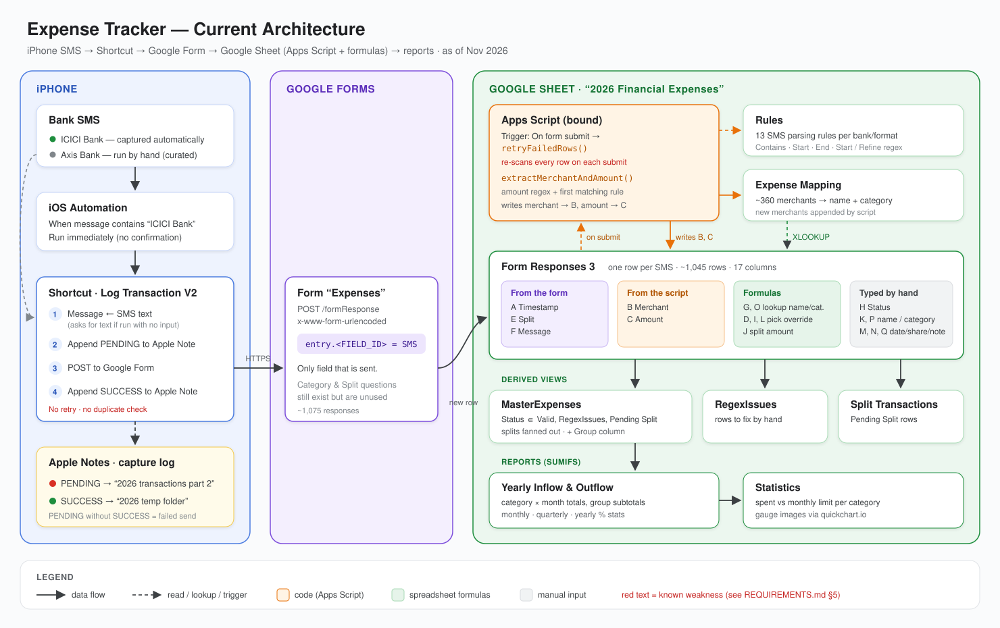

# Expense Tracker — Current Architecture (as-is, read-only audit 2026-11-06)

_Diagram source: [docs/architecture.svg](docs/architecture.svg) (PNG copy: [docs/architecture.png](docs/architecture.png)). Requirements: [REQUIREMENTS.md](REQUIREMENTS.md)._

## 1. Ingestion — Apple Shortcut
| Step | Action |
|---|---|
| Trigger | iOS Personal Automation: "When I get a message containing **'ICICI Bank'**" → Run Immediately → Log Transaction V2. Only ICICI SMS are auto-captured. Axis Bank SMS are sent by running the shortcut manually (user curates them personally); the shortcut's "Ask For Text" fallback supports this. |
| Receive | Shortcut input from share sheet / automation; if empty, asks for text |
| Audit log | Appends `PENDING` line to an Apple Note before sending, `SUCCESS` line after — a poor-man's outbox/ack log |
| Send | `POST https://docs.google.com/forms/d/e/<FORM_ID>/formResponse`, header `Content-Type: application/x-www-form-urlencoded`, body (Form) with one field: `entry.<MESSAGE_FIELD_ID> = Message`. Category and Split are **not** sent. |

No retry in the shortcut: if the POST fails, the note keeps a PENDING line with no matching SUCCESS.

## 2. Form "Expenses" (3 questions, ~1,075 responses)
| Question | Type | entry id | Options |
|---|---|---|---|
| Category | Dropdown | <CATEGORY_FIELD_ID> | Food, Groceries, Transport, Travel, Entertainment, Shopping, Family, Fitness, Mutual Funds, Chitfund, Gold Physical, Stocks, Household, Personal Care |
| Split | Multiple choice | <SPLIT_FIELD_ID> | Yes / No |
| Message | Paragraph | <MESSAGE_FIELD_ID> | raw SMS text |

## 3. Sheet tabs
| Tab | Role |
|---|---|
| **Form Responses 3** | Raw + enriched transactions (≈1,045 rows) |
| **Rules** | Bank-SMS parsing rules (13 rows): `Type, Contains, Start, End, Refine Regex, Start Regex` |
| **Expense Mapping** | Merchant dictionary (≈360 rows): `Transaction Identifier → Expense name, Is New, Category` |
| **spends added manually** | Essentially empty |
| **RegexIssues** | `QUERY` of rows whose Status = `RegexIssues` |
| **Split Transactions** | `QUERY` of rows whose Status = `Pending Split` |
| **MasterExpenses** | Flattened ledger: Date, Identifier, Expense Name, Amount, Split Amount, Category, SuperCategory |
| **Yearly Inflow & Outflow** | Monthly SUMIFS matrix by category, monthly/quarterly/yearly % stats, expected-vs-actual allocations |
| **Statistics** | Month × Category: spent vs limit, % used, quickchart.io radial-gauge URL, SuperCategory |

### Form Responses 3 columns
| Col | Field | Source |
|---|---|---|
| A | Timestamp | Form |
| B | Transaction Identifier (merchant) | **Apps Script** (regex) |
| C | Expense amount | **Apps Script** (regex `(Rs\.?|INR)\s*([\d,]+\.\d{2})`) |
| D | Category | `IF(P="", O, P)` — manual override else automated |
| E | Split | Form |
| F | Message | Form |
| G | Automated Expense Name | `XLOOKUP(B, Mapping!A, Mapping!B, "No Vendor Available")` |
| H | Expense Status | Manual: `Valid` / `RegexIssues` / `Pending Split` / … |
| I | Date | `IF(ISBLANK(M), A, M)` |
| J | Split Amount | `IF(E is No/FALSE, C, N)` |
| K | Manual Expense | Manual |
| L | Expense Name | `IF(G="No Vendor Available", K, G)` |
| M | Override Date | Manual |
| N | Share Amount | Manual (your share when split) |
| O | Automated Category | `XLOOKUP(B, Mapping!A, Mapping!D)` with fallbacks |
| P | Manual Category | Manual |
| Q | Description | Manual |

Note: the form's own Category answer is effectively superseded — D is a formula over O/P.

## 4. Apps Script (single file, bound to the Sheet)
- **Trigger:** `From spreadsheet – On form submit → retryFailedRows` (last run Nov 6, 2026).
- `retryFailedRows()` — scans **every** row of the active sheet; reprocesses rows where B is blank, `Manual Review Needed`, or G is blank/`No Vendor available`. Writes B/C and appends unseen merchants to Expense Mapping (`[merchant, merchant, true]`).
- `processNewFormResponse(e)` — single-row version of the same; exists but **not wired** to a trigger.
- `extractMerchantAndAmount(msg)` — rule engine:
  1. Amount via regex.
  2. For each Rules row: all comma-separated `Contains` tokens must appear in the SMS.
  3. Cut merchant text between `Start` (or `Start Regex` match) and `End`.
  4. Optionally apply `Refine Regex` capture group 1.
  5. First matching rule wins.

## 5. Categorisation hierarchy
- **SuperCategory** (MasterExpenses col H via MAP/LAMBDA):
  - Earning: Salary, Dividends, TaxReturns, Others
  - Payments: Household, Groceries, Transport, PersonalCare
  - Savings: MutualFunds, Stocks, Fixed, Recurring, GoldStock, Gold, Chits
  - Expenses: Fitness, Entertainment, Gaming, Food, Travel, Family, Shopping
- MasterExpenses includes only rows with Status matching `Valid|RegexIssues|Pending Split`; a split `D` with multiple comma-separated categories is fanned out into multiple rows.

## 6. Observed issues / fragilities (inform the software design)
1. **O(n) on every submit:** trigger runs the full-sheet `retryFailedRows` instead of the per-row handler; each row write is a separate `setValue` call. Will slow down as rows grow (Apps Script 6-min limit).
2. **Case mismatch bug:** script checks `"No Vendor available"` but the formula emits `"No Vendor Available"`, so that retry condition never fires.
3. `ss.getActiveSheet()` inside a trigger relies on Form Responses 3 being the first tab.
4. Category taxonomy is inconsistent across layers: the form uses `Mutual Funds`, `Chitfund`, `Gold Physical`, `Personal Care`; formulas use `MutualFunds`, `Chits`, `Gold`, `PersonalCare` (plus typo `Entertainmet`).
5. Hard-coded ranges (`A2:A1001`, `Mapping!A$1:A1146`) cap the system at ~1,000 transactions/year.
6. Card/account suffixes are baked into Rules `Contains` strings — a new card means editing rules.
7. Shortcut has no retry/dedup; duplicates are possible if a message is re-delivered; failures are only visible in Apple Notes.
8. No credits/inflows parsing — Inflow rows are all 0 (income is not captured by this pipeline).
9. Status column H is fully manual, so the "Valid" gate depends on human review.

## 7. Mapping to a software design (starting point)
| Current piece | Software equivalent |
|---|---|
| Shortcut → Form POST | Shortcut → `POST /transactions` (auth token, idempotency key = hash of SMS + time) |
| Apple Notes PENDING/SUCCESS | Server-side ingestion log + client retry |
| Rules tab + `extractMerchantAndAmount` | Parser service with versioned rule table (same 6 fields), unit tests per bank template |
| Expense Mapping | `merchants` table (alias → canonical name, category) with "new merchant" review queue |
| Columns H/K/M/N/P/Q overrides | Editable fields on a transaction + review inbox (RegexIssues, Pending Split) |
| MasterExpenses / Split fan-out | `transaction_splits` table, SQL view for ledger |
| Yearly / Statistics tabs | Aggregation queries + dashboard (monthly by category, budgets vs actuals, gauges) |
